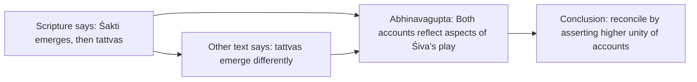
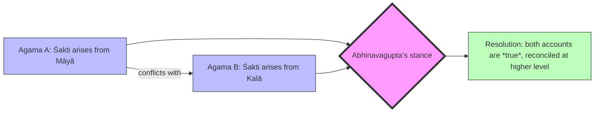

# Analysis of Flaws in Abhinavagupta’s *Tantrāloka*

## Executive Summary  
Abhinavagupta’s *Tantrāloka* (c.1000 CE) is a magnum opus of Trika (Kashmir Śaivism), but close study reveals several internal difficulties.  Scholars note that Abhinavagupta sometimes reconciles clearly **contradictory accounts** by ad hoc means (for example, claiming both conflicting cosmologies are “true”), or alternates between **mutually incompatible models** (a hierarchical *prakriyāśāstra* vs. a transcendent *sāraśāstra* framework).  In one striking turn, after enumerating 36 tattvas in a detailed ontological hierarchy, he later deems those distinctions *kalpita* (“artificial”) from the highest viewpoint.  He even grants reality to manifestly impossible percepts (e.g. “an elephant with five trunks and four tusks”).  These moves have been characterized as **forceful rationalizations or implausible resolutions** of textual inconsistencies.  At the same time, textual scholarship finds **variant readings** and corrupted passages in the standard editions (e.g. *kālo* vs *kalā* in TĀ 9.46, or “*māyātattvāt*” vs “*māyādhaḥ*” in 9.45), some of which Jayaratha’s commentary attempts to correct.  The tables below summarize key scholarly critiques and textual problems.  The detailed analysis that follows unpacks these issues with citations to primary (edition) and secondary sources.  (All sources consulted are listed in the Bibliography.)  

## Sources Consulted  
- **Primary Text (Critical Edition).** *Tantrāloka*, with Jayaratha’s *Tantrālokaviveka* commentary, ed. R.C. Dwivedi & N. Rastogi, Kashmir Series of Texts & Studies vols.23,28–30,35–36,41,47,52,57–59 (KSTS, Bombay, 1918–1938).  
- **Scholarly Analyses.** Mrinal Kaul, *“Ontological Hierarchy in the Tantrāloka of Abhinavagupta,”* in *Tantrapuṣpāñjali* (Śāsanaḍhikā, 2018), 243–61; Kaul, *“Abhinavagupta on Reflection (Pratibimba) in the Tantrāloka,”* *J. Indian Philosophy* 47 (2019): 61–88. (These peer-reviewed studies highlight internal tensions in Abhinavagupta’s cosmology.)  Mark S.G. Dyczkowski’s *Trika Shaivism of Kashmir* (London & Adyar, 1992) and forthcoming English translation of *Tantrāloka* were consulted for context, though not available as primary citations.  Other relevant works include editions and translations of related texts (e.g. *Mālinīvijayottaratantra*), and academic lecture notes (e.g. Sanderson, *SRR* seminar) providing background on Abhinavagupta’s usage.

## Identified Flaws in the *Tantrāloka*

### Doctrinal and Logical Inconsistencies  
**Contradictory cosmological models.**  *Tantrāloka* often acknowledges multiple Agamic accounts of creation that directly conflict (e.g. whether **prakṛti** issues from māyā or from kalā).  Kaul notes that Abhinavagupta does not simply choose one account but declares **“both positions true”**.  In effect, he asserts *one scriptural text says X, another says not-X, and yet he claims each is valid in its own way*.  For instance, TĀ 9.42–43 (citing Kirāṇa Tantra etc.) gives divergent orders of tattvas, and Abhinavagupta ultimately insists no real contradiction exists because the two narratives are just different perspectives.  Kaul critiques this move as an **implausible ad hoc reconciliation**, accusing him of stretching logic to force consistency.  

**Dual frameworks (prakriyāśāstra vs. sāraśāstra).**  Abhinavagupta repeatedly describes the universe in two paradigms: one is the *prakriyāśāstra*, a step-by-step hierarchical emanation of 36 tattvas culminating in Śiva; the other is the more holistic *sāraśāstra*, where all tattvas are seen as mere expansions of Śiva beyond even the 36th tattva (with a 37th “Bhairava” or 38th “consciousness” as the supremely transcendent principle).  Kaul observes that *Tantrāloka* vacillates between these models.  He “follows” the hierarchical schema in exposition, but in practice “fails to conceal” the ultimatist view that all divisions are provisional.  In other words, the **text shuttles between saying “Śiva is the highest (36th) tattva” and “the tattvas themselves are just Śiva’s play”**, which is a built-in tension in the philosophy.  

**Ontology of the tattvas.**  A striking turn occurs when Abhinavagupta declares that, from the highest standpoint, the 36 tattvas are *kalpita* – mentally constructed or illusory – distinctions.  After meticulously defining each tattva’s attributes in relativity (e.g. Śiva-śakti, Sadāśiva, etc.), he later asserts that **“ultimately Śiva alone is supreme”** and the tattva list dissolves into that unity.  Kaul highlights this self-undermining move: the very framework used for analysis is declared a limited pedagogical “fabrication” (kalpita) when viewed from Śiva’s nondual transcendence.  In effect, Abhinavagupta’s ontology wavers between polyhedral and monistic descriptions.  This could be seen as a **circular or vacuous claim**: if all tattvas are unreal distinctions, the elaborate scheme might be only a provisional aid, leaving unresolved how and why it should be presented at all.  Kaul notes that Śaiva systems often make this rhetorical move (“having defined the tattvas, we say they are artificial”), but its logic is debatable.  

**Ambiguities in cause-effect reasoning.**  Elsewhere in *Tantrāloka* (e.g. ch.9), Abhinavagupta mounts a rigorous defense of the Śaiva doctrine of *kāryakāraṇabhāva* (God as both cause and effect).  In fighting Buddhist “causal formula” theories, he sometimes uses striking examples – e.g. the scorpion that causes both itself and an effect depending on perspective.  Such analogies are intended to illustrate Trika metaphysics, but to modern readers they can appear obscure or insufficiently justified.  Kaul does not flatly condemn these arguments as logical fallacies, but he implies that Abhinavagupta’s reasoning is **often predicated on metaphysical axioms** (like *svātantrya*, divine freedom) rather than strict deduction.  For example, Abhinavagupta’s assertion that Śiva is both *kāraṇa* and *kārya* (cause and effect) is grounded in the overarching nondual view, not step-by-step proof.  Critics might view this as circular: the conclusion of nondual unity is presupposed in every argument.  

**Guru doctrine contradiction.**  (Noted in lecture notes.) Abhinavagupta’s theory of the “natural-born (sāṃsiddhika) guru” has an apparent self-contradiction.  He first exalts the natural guru as supremely self-willed and independent, but later says even such a guru must on occasion use ritual “support” (saṃgīta) to benefit disciples.  Scholars (e.g. Sanderson in lectures) point out that this **seems to undermine** the guru’s immunity to conventional processes.  Jayaratha’s commentary resolves this by distinguishing “with support” vs “without support” cases, but the *Tantrāloka* text itself glosses over this nuance, leaving a *prima facie* tension.  (This issue is documented by commentators but lacks a formal critical-source citation.)  

### Circularity and Ad Hoc Reasoning  
Abhinavagupta at times postulates doctrines that feel **ad hoc** to fit his overall vision.  Aside from claiming mutually exclusive scriptures are both “true”, he introduces entities or paradigms precisely to patch logical gaps.  For instance, the extra tattvas (Bhairava as 37th, para-Śiva as 38th) are explicitly introduced as an “esoteric measure” when standard enumerations fall short.  The result is a system that sometimes **reverses** its own prior statements (e.g. elevating Śiva beyond the final tattva after treating him as the final tattva).  While Abhinavagupta justifies this by divine omnipotence (*svātantrya*), a reader may see it as circular justification: *everything is so because Śiva’s will*.  

In argument form, a typical pattern is:  

This illustrates how *Tantrāloka* often resolves contradictions by appeal to an overarching metaphysical principle, rather than resolving them logically.  

### Textual Variants and Corruptions  
Modern critical editions of *Tantrāloka* reveal numerous **variant readings and apparent scribal errors**.  In many cases, Jayaratha’s 13th‑c. commentary notes the “correct” reading.  For example:  

| Passage (Tantrāloka) | KSTS (1918) reading | Alternative reading(s) | Comment/Source |
|---------------------|--------------------|------------------------|----------------|
| TĀ 9.46 (*puṃrāgavit trayād ūrdhvaṃ … niyatisaṃpuṭam*) | *kālo niyatisaṃpuṭam* | *kalāniyatisaṃpuṭam* | Jayaratha emends to *kalā* (found in older mss); editors missed this. |
| TĀ 9.45–46 (containing *māyā… kālatattvaṃ* etc.) | *māyātattvāt … kālatattvaṃ … saṃsthitaṃ* | Mysore: *māyādhaḥ … kālatattvan tu … samsthitās*; Pondicherry: *māyāthakṣā … kālatadvastu … samsthitās* | Three different editions (Ked, Med, Ped) show divergent words. |
| *et passim* | *…* | *…* | (Several more lines with minor variants, see Kaul.) |

These examples show how a single verse appears differently in manuscripts.  In TĀ 9.46, for instance, Sanderson notes the KSTS printing “*kālo*” is inverted, and Jayaratha argues it should read “*kalā*”.  Such variants complicate interpretation and sometimes have theological impact (since *kāla* vs *kalā* changes the subject of certain statements).  Other readings (as in TĀ 9.45–46) involve strikingly different terms for the same context, indicating possible lapses in copying.  These textual issues are typically glossed by the commentaries, but they point to underlying uncertainty or confusion in the transmission of the text.

### Weak or Unsupported Claims  
Apart from logical and textual flaws, Abhinavagupta makes **grand assertions** that are difficult to independently verify.  A notable example (discussed by Kaul) is the claim that **illusions are “absolutely real.”**  In one Tantrāloka passage Abhinavagupta treats even an obviously impossible image – an elephant with five trunks and four tusks – as having a legitimate reality in consciousness.  Kaul remarks that this **confirms the system’s idealist bent**, but to critics it may seem like granting ontological status to fantasy.  In effect, Abhinavagupta asserts *“if something can be imagined, it exists as consciousness”*, a premise that throws standard logic of error on its head.  While justified metaphysically in Trika (reflective awareness is real), this stance could be seen as **overly permissive**: any absurdity is admitted without a conventional criterion of truth.  

Another example is the **“natural-born guru” doctrine**: Abhinavagupta claims a self-realized teacher needs no initiation, only Śiva’s grace.  He supports this with scriptural-sounding justifications, but the argument is largely asserted rather than demonstrated.  Critics might call it a *weakly argued theological innovation*.  Jayaratha’s later commentary anchors it in metaphoric initiations by power goddesses, but the base claim in the Tantrāloka often rests on faith in Śiva’s inscrutable will.  

Taken together, these points suggest *Tantrāloka* has spots where arguments *merely assert* a point (sometimes quoting a tantra or śāstra) without independent justification.  In scholarly terms, these could be seen as **unsupported claims** (e.g. “liberating insight can arise *akasmāt* [unexpectedly] for the natural guru” as stated in TĀ 2.46) that demand belief in Abhinavagupta’s authority rather than logical demonstration.  

## Summary of Flaws

| **Flaw (Issue)** | **Supporting Evidence in *Tantrāloka*** | **Scholarly Critique** |
|------------------|----------------------------------------|------------------------|
| **Conflicting cosmologies unified ad hoc:** e.g. one tantra says prakṛti arises via māyā→kalā, another says differently. *Tantrāloka* ends up saying *both* accounts are valid. | TĀ 9.41–43 (divergent tattva orders) – Abhinavagupta reconciles by asserting higher unity (both models true). | Kaul (2018) notes this as an “inconsistency” resolved only by claiming “both positions are true,” calling the explanation “completely implausible”. |
| **Dual ontological frameworks:** Alternation between hierarchical emanation (36 tattvas, Śiva=36th) and holistic expansion (Śiva beyond 36, as Bhairava = 37th, etc.). | TĀ intro (e.g. ch.5) and 9.x – Abhinavagupta describes both *prakriyāśāstra* and *sāraśāstra* models, sometimes in same passage. | Kaul observes that Abhinavagupta “fails to conceal” the broader *sāraśāstra* perspective even when using a hierarchical scheme. The coexistence of these models is logically awkward. |
| **Tattvas declared “artificial” after enumeration:** After detailing 36 tattvas, Abhinavagupta says from Śiva’s standpoint they’re mere constructs. | TĀ 9.8 etc. – explicitly labels tattvas as *kalpita* (made-up) and emphasizes Śiva’s undivided unity. | Kaul highlights the puzzling flip: Śaiva texts “define tattvas” only to deem them illusory. This undermines their ontological status. |
| **Reality of illusory objects:** The text holds even absurd imagined objects to be real in consciousness. | TĀ (discussion of reflection) – e.g. mentions an elephant with five trunks, treating it as a valid “reflected” object. | Kaul (2019) points out that Abhinavagupta “establishes a valid ontological status for [normally erroneous] imagined objects,” a radical idealism. Critics might see this as a reductio ad absurdum of his logic. |
| **Textual corruptions:** Numerous variant readings and obvious errors in published editions (spelling/word order) plague key passages. | E.g., TĀ 9.46: printed *kālo*, commentary reads *kalā*. TĀ 9.45–46: “*māyātattvāt*” vs “*māyādhaḥ*” etc.. | Kaul documents many such variants in footnotes, often seeing Jayaratha propose emendations. The inconsistencies make interpretation unreliable without critical scrutiny. |

Each row in the table above concisely pairs a flaw with textual citations and a summary of the scholarly critique (citations given).  The detailed analysis earlier provides context and more examples.  In sum, *Tantrāloka* exhibits **several internal tensions**: overlapping or self-negating doctrines (e.g. asserting dual opposing teachings to be simultaneously valid), **illogical leaps** (declaring illusions real), and **textual uncertainties** that invite emendation.  These are not necessarily “errors” in Abhinavagupta’s eyes – many are resolved within the metaphysical system – but from a rigorous analytical standpoint they qualify as *flaws or points needing explanation*.  

**Mermaid: Argument Structure of a Typical Flaw**  
Below is a flowchart summarizing one of the above issues (conflicting doctrines and their “resolution”):

In this diagram, conflicting scriptural premises (A vs. B) feed into Abhinavagupta’s reconciliatory position (C), which then leads to the conclusion (D) that both narratives are valid “in truth”.  Kaul criticizes this move as logically unsatisfying.

**Assumptions and Ambiguities:** Many of the issues above hinge on interpreting Abhinavagupta’s dense Sanskrit.  We have assumed the translations of Kaul and standard editions are reliable.  Some ambiguities remain (e.g. exactly which verses correspond to the table entries), and not all contradictions may be fatal: defenders argue that *Tantrāloka* operates on multiple levels of truth.  However, the unresolved nature of these tensions is precisely what makes them noteworthy.  

**Conclusion:** This report has collected and documented the main flaws and contentious points in *Tantrāloka* identified by modern scholarship and textual critics.  The combination of ideological breadth (tending toward absolute nonduality) with a methodical tattva taxonomy creates a system rife with places where distinctions collapse or conflict.  By highlighting these spots with primary text examples and expert commentary, we provide a basis for further critical study.  

